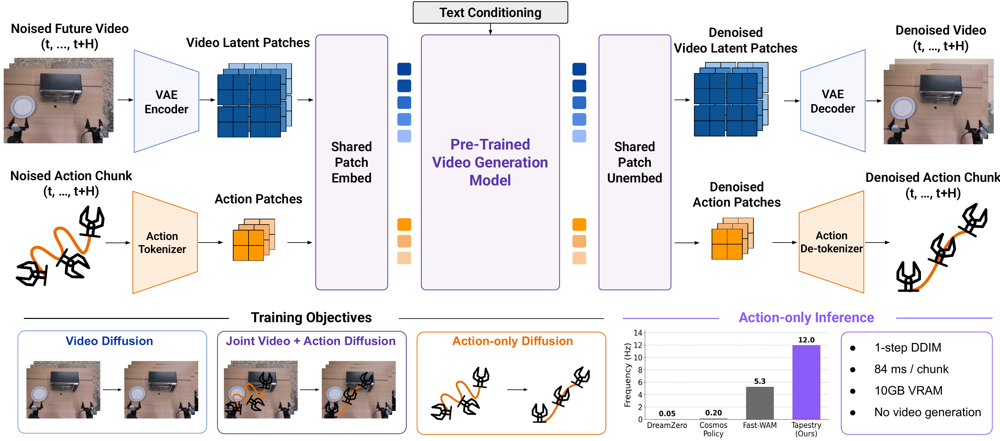

# TAPESTRY: A Single Backbone for Video Generation and Robot Control

Jeremy A. Collins, Seungjae Lee, Rachanon Wachakorn, Krishnan Srinivasan, Animesh Garg, Vitor Campagnolo Guizilini, Paarth Shah

[](https://tapestry-wam.github.io)
[](https://arxiv.org/abs/2610.36823)
[](https://huggingface.co/jeremy-collins/TAPESTRY)
[](https://www.python.org)
[](LICENSE)

This repo contains the official implementation of TAPESTRY: A Single Backbone for Video Generation and Robot Control (CoRL 2026).

TAPESTRY turns a pretrained video diffusion transformer (CogVideoX-2b) into a robot policy without generating video at inference time. Each action timestep becomes one patch in the video VAE's latent space through a single linear map (1,280 parameters for 20-d actions), and passes through the same patchifying convolution and transformer backbone as the video frames. The backbone is fine-tuned with three diffusion objectives:

- **Video diffusion** on unlabeled robot and human video
- **Joint video and action diffusion** with a coupled timestep and block-causal attention
- **Action-only diffusion**, the mode the policy runs in

The policy generates each action chunk from pure noise in a single DDIM step, which takes about 84 ms on an RTX 5090.



## Quickstart with a coding agent

Paste one of these prompts into a coding agent such as Claude Code, Codex or Cursor on the machine with your GPU. The agent follows [`AGENTS.md`](AGENTS.md): it checks your GPUs and disk, proposes a plan and waits for your go-ahead before it downloads or trains anything. It needs network access and permission to run shell commands.

Fine-tune the [pretrained checkpoint](#pretrained-checkpoint) on your robot demos (one GPU with 32 GB):

```
Clone https://github.com/pairlab/TAPESTRY.git, read the AGENTS.md at its root and follow it to
fine-tune the pretrained TAPESTRY checkpoint on my robot demos.
```

Run the policy on your robot (about 10 GB of GPU memory):

```
Clone https://github.com/pairlab/TAPESTRY.git, read the AGENTS.md at its root and follow it to
run the pretrained TAPESTRY policy on my robot.
```

Train and evaluate the [LIBERO recipe](#libero) (four 141 GB GPUs, or a one-task overfit check on one 80 GB GPU):

```
Clone https://github.com/pairlab/TAPESTRY.git, read the AGENTS.md at its root and follow it to
set up TAPESTRY, train the paper's LIBERO recipe and evaluate the trained policy on LIBERO.
```

Training and evaluation run as background jobs that outlive the agent session. To check on one later, open an agent in the clone and paste:

```
Follow AGENTS.md to check on the TAPESTRY run and report its progress or results.
```

## Setup

``` bash
conda create -n tapestry python=3.10 -y
conda activate tapestry
git clone https://github.com/pairlab/TAPESTRY.git
cd TAPESTRY
pip install -e .
```

`pip install -e .` installs PyTorch 2.13 for CUDA 13, which needs NVIDIA driver 580 or newer. With an older driver, first install a PyTorch between 2.6 and 2.13 for your CUDA version from [pytorch.org](https://pytorch.org/get-started/locally/), which `pip install -e .` then keeps. We tested:

``` bash
pip install torch==2.7.0 torchvision==0.22.0 --index-url https://download.pytorch.org/whl/cu128
```

The frozen base models download from HuggingFace on first use: the [CogVideoX-2b](https://huggingface.co/THUDM/CogVideoX-2b) transformer and VAE (about 4 GB) and the [T5-XXL](https://huggingface.co/google/t5-v1_1-xxl) text encoder (about 45 GB, or 9.5 GB with the [fp16 copy](#smaller-t5-download)).

## Pretrained checkpoint

| Checkpoint | Training data | Cameras and actions | Inference GPU memory |
|---|---|---|---|
| [`tapestry.pt`](https://huggingface.co/jeremy-collins/TAPESTRY/blob/main/tapestry.pt) | robot and human video plus bimanual YAM demos ([`cfg/train_tapestry.yaml`](cfg/train_tapestry.yaml)) | front and two wrist cameras; 20-d bimanual `eepose_6drot` | about 10 GB, or 28 GB without caching text prompts |

``` bash
hf download jeremy-collins/TAPESTRY tapestry.pt --local-dir .
```

The 7.6 GB file bundles the policy weights, the training config and the action normalizer, so it needs no other file besides the base models. It drives our bimanual YAM robot and is the starting point for [fine-tuning](#fine-tune-on-your-own-robot) on yours.

## Run a policy

``` python
from tapestry.models.policy import TapestryPolicy

policy = TapestryPolicy("tapestry.pt", device="cuda", num_inference_steps=1, t5_override=None, text_cache_dir="text_cache")
print(policy.cameras, policy.image_size, policy.action_horizon, policy.action_dim)
# ['front_img_1', 'left_wrist_img', 'right_wrist_img'] 128 16 20

actions = policy.act([front_rgb, left_wrist_rgb, right_wrist_rgb], "Pick up the corn and put it in the bowl",
                     ref_action=current_pose)  # [16, 20] numpy
```

- `act` takes one `[image_size, image_size, 3]` uint8 RGB array per camera, in `policy.cameras` order. Resize each full camera frame to that size without cropping (bilinear), as the data loader does.
- `ref_action` is the robot's current pose in the action layout of [fine-tuning step 1](#1-write-your-demos-as-hdf5-one-file-per-demo). The model predicts poses relative to it, and `act` returns absolute poses ready to execute. Delta action spaces such as LIBERO's need no `ref_action`.
- Execute the first few actions of each chunk and re-plan (our LIBERO evaluation executes 8 of 16), or blend overlapping chunks with temporal aggregation as in `tapestry/eval_libero.py`.
- `text_cache_dir` keeps T5 off the GPU, which brings inference to about 10 GB. Each new instruction is encoded once with T5 on the CPU (about 20 GB of RAM) and saved in that directory for later runs, so call `policy.text_embedding(text)` for your instructions before the control loop, or fill the directory on another machine and copy it over. `text_cache_dir=None` keeps T5 on the GPU (about 28 GB).
- `t5_override="THUDM/CogVideoX-2b"` loads the [smaller fp16 T5](#smaller-t5-download) in place of the one the checkpoint was trained with.

[`scripts/policy_example.py`](scripts/policy_example.py) runs this loop in LIBERO with a checkpoint exported as in [step 4](#4-export-and-deploy) of fine-tuning. Copy it for your robot.

## Fine-tune on your own robot

LoRA fine-tuning from the pretrained checkpoint runs on one 32 GB GPU.

#### 1. Write your demos as HDF5, one file per demo

| Dataset | Shape | Content |
|---|---|---|
| `actions/<action_space>` | `(T, D)` float | `D = ACTION_SPACE_CONFIGS[action_space]["total_dim"]` (`tapestry/utils/action_normalizer.py`) |
| `observations/images/<camera>` | `(T, H, W, 3)` uint8 | one dataset per camera, any names |
| `text` | scalar string | task description; add it with `python scripts/add_text_to_hdf5.py --demo-dir data/my_robot --text "pick up the cup"` |

- Built-in action spaces are `eepose_6drot` (20-d, the paper's), `eepose_ypr` (14-d), `joints` (14-d) and `libero` (7-d deltas). A new one is an entry in `ACTION_SPACE_CONFIGS` that gives its total dim, the dims to normalize and whether actions are deltas.
- `eepose_6drot` stores each arm as `[x, y, z, R00, R01, R10, R11, R20, R21, gripper]` (dims 0-9 and 10-19), with the first two columns of the rotation matrix interleaved row-major as in `matrix_to_rot6d_np` (`tapestry/utils/action_preprocess.py`).
- All scripts read every `*.hdf5` directly inside the demo directory, in filename order.

#### 2. Compute action-normalization statistics

``` bash
python scripts/compute_normalizer_stats.py --demo-dir data/my_robot --action-space eepose_6drot \
    --horizon 16 --output data/my_robot/normalizer_stats.json --relative-rotation-actions
```

`--horizon` is the action-chunk length (`training.true_horizon`). `--relative-rotation-actions` makes rotations relative to the chunk start (`eepose_6drot` only) and must match `training.dataset.relative_rotation_actions`.

#### 3. Train

``` bash
accelerate launch train.py --config-name finetune init_from=tapestry.pt \
    training.dataset.demo_root_dir=data training.dataset.demo_dir=my_robot \
    training.dataset.normalizer_stats_path=data/my_robot/normalizer_stats.json \
    'cond_cameraviews=[front_img_1,left_wrist_img,right_wrist_img]'
```

[`cfg/finetune.yaml`](cfg/finetune.yaml) keeps the paper's architecture and objectives, trains LoRA adapters on the frozen backbone and holds out the last 10% of demos for validation, so the directory needs at least 6 demos. Checkpoints land in `checkpoints/<experiment_name>/`, or `checkpoints/<experiment_name>_1/` when that exists: `latest.pt` every epoch, `epoch_N.pt` every 10 epochs and `best_checkpoint.pt` at the lowest validation action loss, 7.7 GB each.

- `init_from` loads weights only, so a checkpoint trained on another action space still works: the action projection is re-initialized and everything else is inherited. Set `model.action_dim` and `training.dataset.action_space` together, for example `training.dataset.action_space=joints model.action_dim=14 training.dataset.relative_rotation_actions=false`, and compute the statistics in step 2 with the same `--action-space`.
- `cond_cameraviews` lists the cameras the policy sees, in order, up to three. Deployment must use the same cameras in the same order.
- Full fine-tuning needs both `decoders.cogvideox.use_lora=false` and `decoders.cogvideox.freeze_pretrained_weights=false`.
- `resume=true` continues the latest run of this `experiment_name` with its saved config plus any overrides. Optimizer settings cannot change during a resume, so use `init_from` for a fresh optimizer.
- `accelerate launch` trains on every visible GPU with `training.batch_size` samples on each. Add `--num_processes 1` for one GPU.

#### 4. Export and deploy

``` bash
python scripts/prepare_release_checkpoint.py --checkpoint checkpoints/tapestry_finetune/epoch_50.pt --output my_robot.pt --verify
```

`my_robot.pt` loads in `TapestryPolicy` as in [Run a policy](#run-a-policy).

## Train from CogVideoX-2b

The paper's real-world recipe fully fine-tunes the backbone:

``` bash
pip install -e ".[decord]"   # video decoding for the video-only datasets
accelerate launch train.py --config-name train_tapestry
```

Its data mixture ([`cfg/data/tapestry_paper.yaml`](cfg/data/tapestry_paper.yaml)):

| Share | Data | Actions |
|---|---|---|
| 44.5% | cross-embodiment robot and human video from the [Large Video Planner](https://arxiv.org/abs/2512.15840) mixture | no |
| 50% | robot demos, 12.5 points of which are play data | yes |
| 5.5% | task-aligned human video | no |

- Our robot datasets are template entries in the config, so point them at your HDF5 demo directories ([layout](#1-write-your-demos-as-hdf5-one-file-per-demo)).
- Each video-only dataset reads a metadata CSV with the columns documented in [`tapestry/loaders/video_only_dataset.py`](tapestry/loaders/video_only_dataset.py). [`tapestry/loaders/path_translator.py`](tapestry/loaders/path_translator.py) documents the on-disk layout of droid, ego4d, epic_kitchens, ssv2, pandas (Panda-70M), bridge and agibot.
- For droid, ego4d, epic_kitchens and ssv2, place the `cleaned_metadata.csv` files of the [LVP release](https://huggingface.co/KempnerInstituteAI/LVP/tree/main/data) at each entry's `metadata_path` under `training.dataset.root_dir`. Our Panda-70M, Bridge and AgiBot CSVs (re-cut clips and multi-view entries) are not released, so build these with the same columns.
- `translate_paths: false` resolves `video_path` relative to `root_dir`, which only works for single-camera entries (`cond_cameraviews: null`).

The LIBERO recipe is under [Train on LIBERO](#train-on-libero).

#### Overrides

Any config value can be overridden from the command line, such as `training.batch_size=8 evaluation.eval_every=1`.

| Override | Effect |
|---|---|
| `decoders.cogvideox.joint_diffusion_mix_prob` | fraction of samples with both targets that train with the joint objective |
| `decoders.cogvideox.use_lora`, `decoders.cogvideox.freeze_pretrained_weights` | LoRA or full fine-tuning |
| `training.dataset.datasets.<name>.batch_weight` | batch composition across datasets |
| `evaluation.num_inference_steps` | DDIM steps during in-training evaluation (1 in the paper) |
| `quick=true` | 10-sample datasets for smoke tests |

The loss weights live under `training.objectives` (real-world: action 1.0 and video 0.1; LIBERO: action 0.03 and video 1.0). Their names contain a slash, so pass them as a quoted dict:

``` bash
accelerate launch train.py --config-name train_libero \
    'training.objectives={action/future_frames:{weight:0.1},video/future_frames:{weight:1.0}}'
```

## LIBERO

The paper also evaluates on an action-free variant of the [LIBERO](https://github.com/Lifelong-Robot-Learning/LIBERO) simulation benchmark, where only libero_90 has action labels and libero_10, libero_object, libero_spatial and libero_goal contribute video alone and are evaluated zero-shot.

| Run | Hardware we ran it on | Disk | Time |
|---|---|---|---|
| [Recipe](#train-on-libero) for 7 epochs, then evaluation on the four held-out suites | four H200 GPUs with 141 GB each | about 370 GB | about 3 days |
| [Overfit check](#overfit-one-libero-task) for 20 epochs on one task, then evaluation on that task | one H200 GPU, of which it used 47 GB | about 210 GB | 6 to 11 hours |

#### Install LIBERO

LIBERO requires [CMake](https://cmake.org/download/). See [Notes](#notes) for issues with `egl_probe` or a stale LIBERO config.

``` bash
git clone https://github.com/Lifelong-Robot-Learning/LIBERO.git
cd LIBERO
pip install -r requirements.txt
pip install -e . --config-settings editable_mode=compat   # a plain "pip install -e ." leaves libero unimportable
pip install gymnasium robosuite==1.4.1 mujoco==3.2.2   # the simulator versions we tested
mkdir -p libero/datasets   # LIBERO prints a warning on every call while this folder is missing
echo N | python -c "import libero.libero"   # writes ~/.libero/config.yaml with the default paths inside LIBERO
cd ..
pip install -e .   # LIBERO pins old versions of transformers and numpy, and this restores ours
```

Evaluation only needs the simulator. Training also needs the demonstrations of all five suites (about 100 GB) from the [LIBERO HuggingFace dataset](https://huggingface.co/datasets/yifengzhu-hf/LIBERO-datasets), and the overfit check only reads `libero_object` (about 7 GB, add `--include "libero_object/*"`):

``` bash
hf download yifengzhu-hf/LIBERO-datasets --repo-type dataset --local-dir LIBERO/libero/datasets
mkdir -p preprocessed_data && ln -s "$(realpath LIBERO/libero/datasets)" preprocessed_data/libero_demos
```

#### Train on LIBERO

``` bash
accelerate launch --multi_gpu --num_processes 4 train.py --config-name train_libero
```

`training.batch_size` is per GPU, and its default of 32 on 4 GPUs gives the paper's batch of 128 but needs more than 80 GB per GPU. Other GPU counts work with a per-GPU batch that keeps the product at 128, such as `--num_processes 8 training.batch_size=16`, although we have only run this code on four. In-training evaluation runs every `evaluation.eval_every` epochs, and each epoch keeps a 21 GB checkpoint.

#### Evaluate on LIBERO

``` bash
python eval_libero_parallel.py checkpoint=checkpoints/tapestry_libero_taskgen/latest.pt \
    'suites=[libero_10,libero_object,libero_spatial,libero_goal]' n_rollouts_per_task=50
```

The evaluator starts one worker per visible GPU and reads the cameras, image size, action horizon and action dimension from the checkpoint. On a 32 GB GPU set `n_envs=5`. With the defaults, the four suites take about an hour at 10 rollouts per task on one 80 GB GPU. The other options (`task_ids`, `seed`, `temporal_agg`, `execution_horizon`, `num_inference_steps`, `results_file`, ...) are in [`cfg/eval_libero_parallel.yaml`](cfg/eval_libero_parallel.yaml).

#### Overfit one LIBERO task

[`cfg/overfit_libero.yaml`](cfg/overfit_libero.yaml) trains on a single task with no video-only data, which checks training and inference end to end on one GPU:

``` bash
mkdir -p preprocessed_data/overfit/libero_demos/libero_object_t0
ln -s "$(realpath preprocessed_data/libero_demos/libero_object/pick_up_the_alphabet_soup_and_place_it_in_the_basket_demo.hdf5)" \
    preprocessed_data/overfit/libero_demos/libero_object_t0/
accelerate launch --num_processes 1 train.py --config-name overfit_libero \
    training.dataset.root_dir=preprocessed_data/overfit
python eval_libero_parallel.py checkpoint=checkpoints/libero_overfit/epoch_20.pt \
    'suites=[libero_object]' 'task_ids=[0]' n_rollouts_per_task=50 n_envs=5
```

The policy only starts to succeed late in training, so evaluate `epoch_15.pt` and `epoch_20.pt`. On a 32 GB GPU, `decoders.cogvideox.use_lora=true decoders.cogvideox.freeze_pretrained_weights=true training.batch_size=2` runs the same path as a smoke test, although we only validated task success with full fine-tuning. `scripts/verify_libero_data.py` replays the recorded actions of a task, which checks the simulator independently of any model.

## Notes

#### Single-step inference
Multi-step DDIM adds high-frequency jitter to action chunks, while one step from pure noise gives smooth chunks. The analysis scripts:

- `scripts/eval_teacher_forced.py`: teacher-forced jitter sweep on HDF5 demos
- `scripts/eval_determinism_at_t.py`: determinism at a given timestep
- `scripts/benchmark_tapestry_latency.py`, `scripts/benchmark_tapestry_fullpath.py`: latency without T5 encoding

#### Smaller T5 download
The original [T5-XXL](https://huggingface.co/google/t5-v1_1-xxl) downloads as a 45 GB fp32 file that also holds the unused decoder. The [CogVideoX-2b repository](https://huggingface.co/THUDM/CogVideoX-2b/tree/main/text_encoder) ships the same encoder in fp16 (9.5 GB), whose embeddings differ only by rounding. Pass `t5_override=THUDM/CogVideoX-2b` to `eval_libero_parallel.py`, `t5_override="THUDM/CogVideoX-2b"` to `TapestryPolicy` or `--t5-override THUDM/CogVideoX-2b` to the scripts that take a `--checkpoint`, and set `encoders.text.model_name_or_path=THUDM/CogVideoX-2b` when training.

#### wandb
Logging to [Weights & Biases](https://wandb.ai) is off by default. Log in with `wandb login` and add `training.wandb.use_wandb=true` for training or `use_wandb=true` for `eval_libero_parallel.py`, which also saves the first LIBERO rollout of each task as a video. `training.wandb.project` and `wandb_project` choose the project.

#### Tests

``` bash
pip install -e ".[test]"
python -m pytest tests/
```

#### Checkpoints on network filesystems
Checkpoints are memory-mapped at load time, which can drop to a few MB/s on Lustre or NFS. Copy the checkpoint to local disk first.

#### Issues with `egl_probe`
LIBERO depends on `egl_probe`, which needs CMake and a C++ compiler to build. Install the build tools, then retry:
``` bash
conda install -c conda-forge cmake cxx-compiler
python -m pip install egl-probe
```

#### Eval fails with a relative `LIBERO/...` FileNotFoundError
LIBERO caches its paths in `~/.libero/config.yaml` on first import, and a stale config from an older checkout breaks path resolution. Delete it (`rm ~/.libero/config.yaml`) and regenerate it with the `echo N | python -c "import libero.libero"` line from [Install LIBERO](#install-libero). Set `LIBERO_CONFIG_PATH=<dir>` to keep a separate config per checkout.

## Acknowledgements
TAPESTRY builds on [CogVideoX](https://github.com/THUDM/CogVideo) and its implementation in [diffusers](https://github.com/huggingface/diffusers). Simulation experiments use [LIBERO](https://github.com/Lifelong-Robot-Learning/LIBERO).

## Citation
If you find this work useful, please use the following citation:
```
@inproceedings{collins2026tapestry,
    title={TAPESTRY: A Single Backbone for Video Generation and Robot Control},
    author={Jeremy A. Collins and Seungjae Lee and Rachanon Wachakorn and Krishnan Srinivasan and Animesh Garg and Vitor Campagnolo Guizilini and Paarth Shah},
    booktitle={Conference on Robot Learning (CoRL)},
    year={2026}}
```

## License
TAPESTRY is released under the [MIT License](LICENSE). [`tapestry/video_diffusion/cogvideox_transformer_3d.py`](tapestry/video_diffusion/cogvideox_transformer_3d.py) is adapted from diffusers and keeps its Apache 2.0 license, and [`tapestry/utils/libero_utils/custom_venv.py`](tapestry/utils/libero_utils/custom_venv.py) is adapted from LIBERO and keeps its MIT license. The pretrained checkpoint is fine-tuned from CogVideoX-2b and uses the T5-XXL encoder, both released under the Apache 2.0 license.
